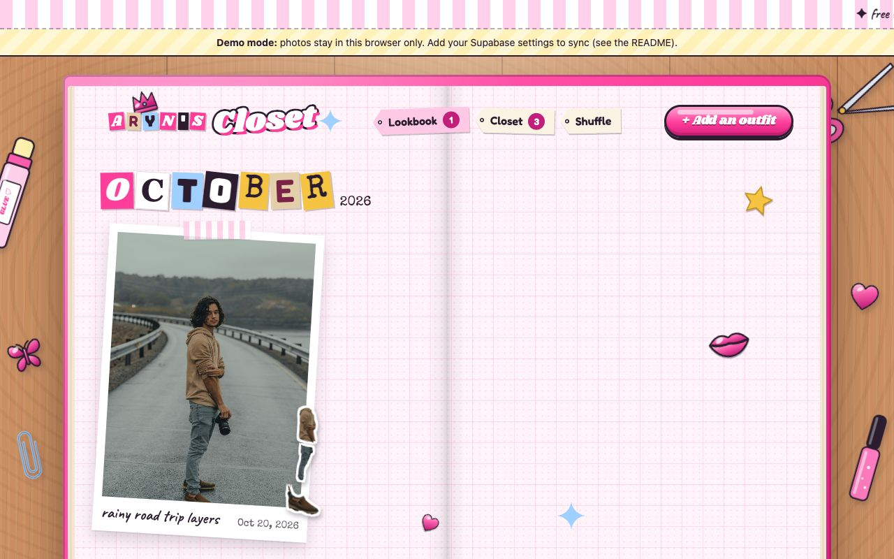
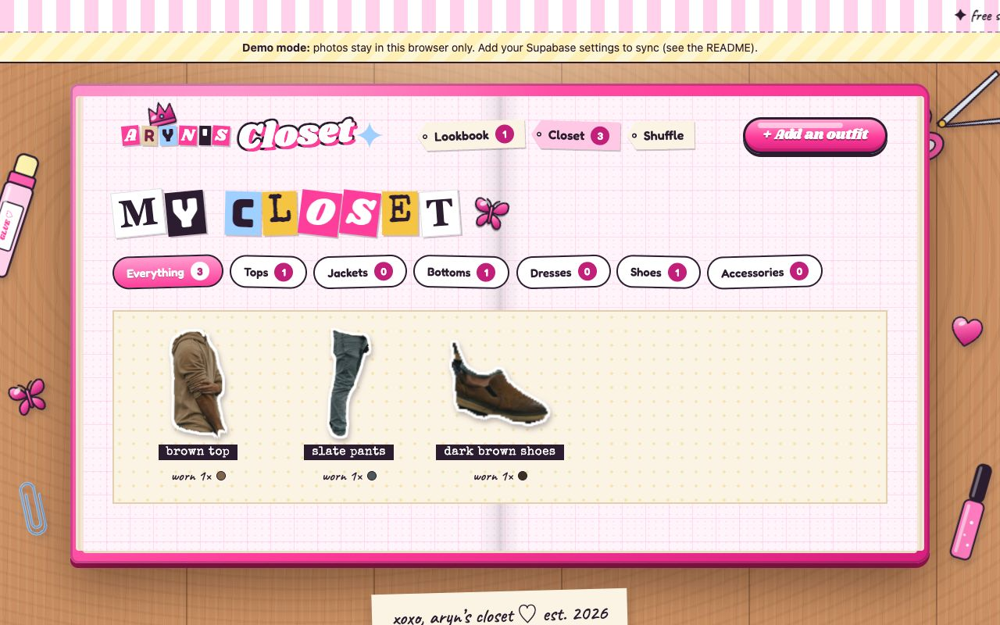
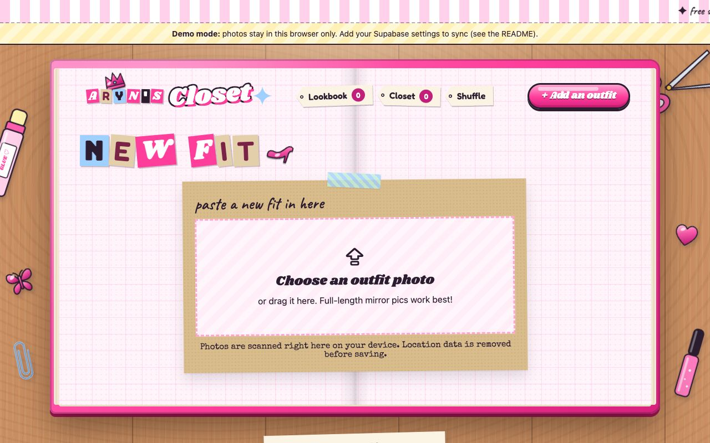
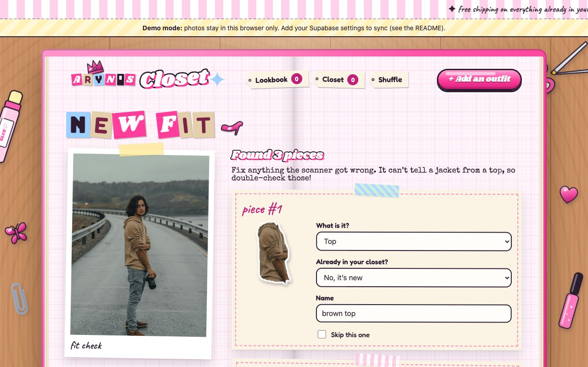
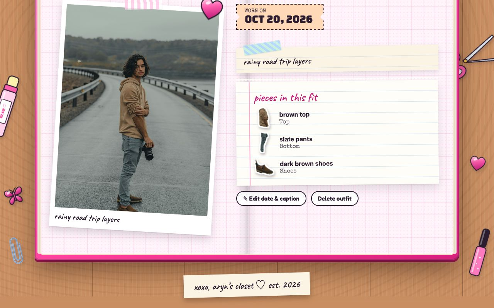
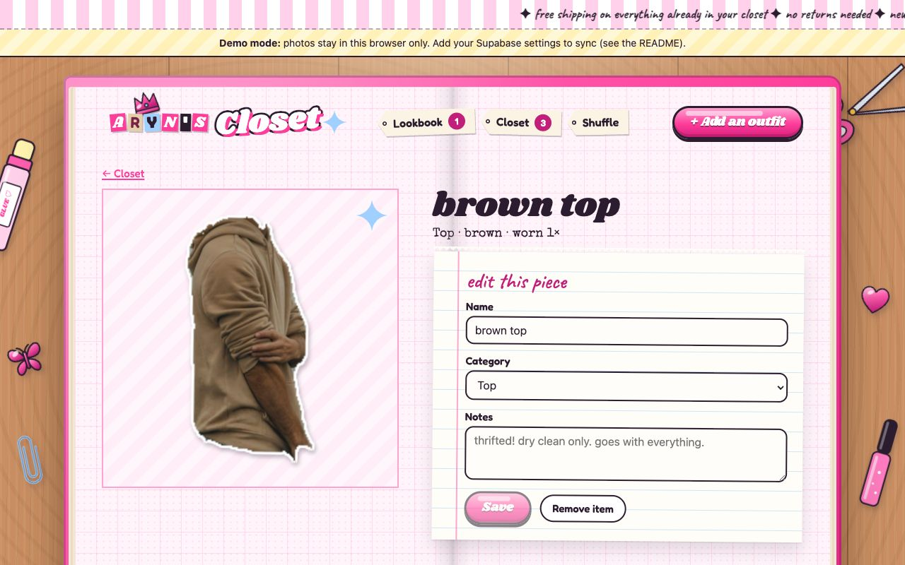
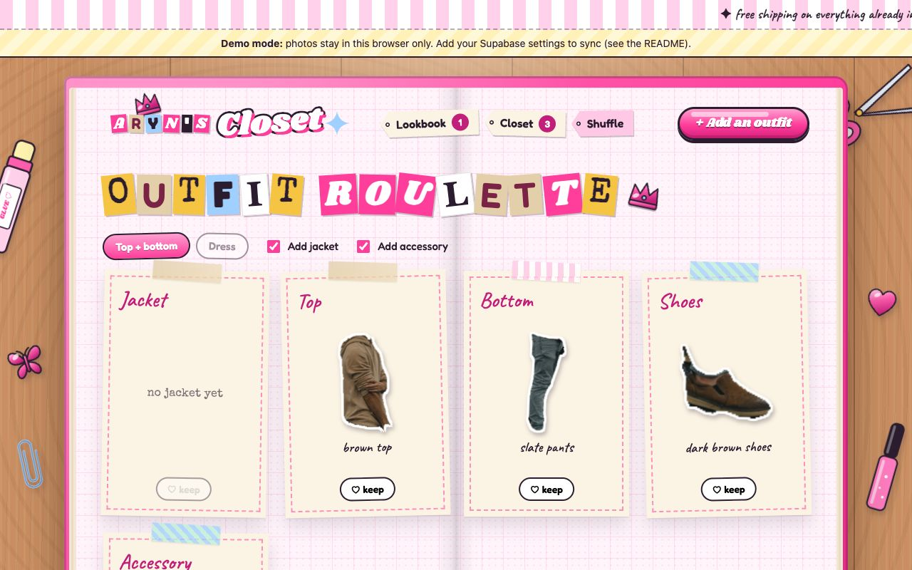

# Aryn’s Closet ♡

Live at **[closet.arynlynn.com](https://closet.arynlynn.com)**.

A Bratz-meets-scrapbook digital closet: an open scrapbook on a desk, with glossy pink icons, tape, polaroids, and stickers. Upload outfit photos and they become a lookbook. Each fully visible piece of clothing is automatically cut out into a sticker and cataloged in your closet. The outfit roulette shuffles those pieces into new looks.

- **Lookbook:** outfit photos as taped-in polaroids, grouped into monthly scrapbook spreads with ransom-note headings.
- **Clothing scanner:** finds tops, bottoms, dresses, shoes and accessories in a photo, cuts each one out as a transparent sticker, and names its color.
  - Anything cut off at the photo's edge or mostly hidden gets a dismissible error popup instead of being cataloged. The full photo still goes in the lookbook.
  - Runs entirely in your browser (see below).
- **Review before saving:** fix categories (the scanner can't tell a jacket from a top), rename pieces, skip any, or say "this is already in my closet" to tag an existing item instead of duplicating it.
- **Closet:** every piece as a sticker, filtered by category, with how many times you've worn it.
- **Outfit roulette:** a random top + bottom (or dress) + shoes, optionally with a jacket and an accessory. Lock pieces you like and shuffle the rest.

Built with React, TypeScript and Vite. Uses [Supabase](https://supabase.com) for login, data and private photo storage, and [Transformers.js](https://github.com/huggingface/transformers.js) for on-device clothing segmentation.

## Screenshots

Taken in demo mode from the production build at 1280×800, using a free [Unsplash sample photo](https://images.unsplash.com/photo-1643310325061-2beef64926a5). Update them whenever a page's look changes (they live in `docs/screenshots/`).

| Lookbook | Closet |
| --- | --- |
|  |  |
| **Add an outfit** | **Review what the scanner found** |
|  |  |
| **Outfit page** | **Item page** |
|  |  |
| **Shuffle (outfit roulette)** | |
|  | |

## Run it

Requires Node.js LTS and npm.

```sh
npm install
npm run dev       # http://localhost:5174
npm run build     # type-check and build to dist/
npm run preview   # serve the production build
npm run lint      # ESLint (TypeScript + React hooks rules)
npm test          # unit tests (Vitest)
```

Every pull request runs lint, type-check, tests and a build in GitHub Actions (`.github/workflows/ci.yml`).

**What the tests cover** (`npm test`):
- **Scanner rules** (`src/vision/masks.test.ts`): what counts as fully visible versus cut off or too small, including the exact edge boundary, noise, and shoes when the feet aren't in frame.
- **Page ↔ scanner worker** (`src/vision/scanner.test.ts`): results, progress, worker errors and crashes, unreadable photos, and cancelling at every stage, using a fake worker.
- **Storage contract** (`src/lib/store.contract.test.ts`): the demo store and the Supabase store pass the same suite (save, load, photo links, edit, delete, missing records). The Supabase store runs against an in-memory fake client (`src/test/fakeSupabase.ts`), including rollback when a save fails partway, and loading closets bigger than one page (the fake enforces Supabase's row limit and, like Postgres, returns tied rows in no set order).
- **Photo dates** (`src/lib/photoDate.ts`): reading the date taken from JPEG, PNG and WebP metadata in both byte orders, falling back sensibly, and ignoring future, blank or impossible dates and broken files without errors.
- **Outfit shuffle, colors and dates.**

The first `dev` or `build` runs `scripts/fetch-model.mjs`. It downloads the clothing model (about 15 MB) from Hugging Face at a pinned revision, checks each file's SHA-256, and copies the ONNX Runtime WebAssembly files into `public/`. Both folders are gitignored.

Without Supabase settings, the app runs in **demo mode**: photos are saved only in that browser (IndexedDB).

## Supabase setup (one time)

1. Create a new Supabase project.
2. **SQL Editor → New query:** paste in [`supabase/schema.sql`](supabase/schema.sql) and run it. This creates the `outfits`, `items` and `outfit_items` tables and a **private** `closet` storage bucket, with Row Level Security so each user can only reach their own rows and photos (stored under `<user id>/…`).
3. **Authentication → Users → Add user:** create your account, with **Auto Confirm User** checked.
4. **Authentication → Sign In / Providers:** turn **off** “Allow new users to sign up”.
5. **SQL Editor → New query:** paste in [`supabase/public-view.sql`](supabase/public-view.sql) and run it, after creating your account. This makes the closet **public and read-only**:
   - Anyone can browse your lookbook, closet and shuffle, photos included.
   - Photos are served through short-lived signed links, and the bucket stays private.
   - Only you, signed in, can add, edit or delete.
   - It sets your account (the project's only user) as the owner.
   - Until this is run, the app asks visitors to sign in before showing anything, as before.
6. Copy `.env.example` to `.env.local` and fill in the **Project URL** and **publishable key**.

**Signing in:** visitors can look around. You sign in with **sign in ♡** in the header. **+ Add an outfit**, editing and deleting appear once you're signed in.

Never put the secret / `service_role` key in this app or repo.

## How the clothing scanner works

- **Model:** [`Xenova/segformer_b0_clothes`](https://huggingface.co/Xenova/segformer_b0_clothes), an ONNX conversion of [`mattmdjaga/segformer_b0_clothes`](https://huggingface.co/mattmdjaga/segformer_b0_clothes). It runs in a Web Worker with ONNX Runtime Web (WebAssembly, CPU).
- **Privacy:** photos are never sent anywhere for analysis.
- **How it works:**
  - The model labels every pixel (upper clothes, pants, skirt, dress, shoes, hat, bag, scarf, belt, sunglasses…).
  - Labels are grouped into closet categories, and stray specks are removed.
  - Each piece is checked: anything that touches the photo's edge is "cut off", and anything below a minimum size is "too small or mostly hidden".
  - Shoes are ignored when the legs run off the bottom of the photo, since the model sometimes mistakes bags or cameras for shoes.
- **Color:** the main color comes from the item's pixels, ignoring shadows, and is matched to a friendly name.
- **Tuning:** thresholds live at the top of [`src/vision/worker.ts`](src/vision/worker.ts).
- **Limits:** the model can't distinguish a jacket from a top and may merge layered tops, so the review step lets you fix that. It works best on clear, full-length photos.
- **License:** the model's license is listed as “other” on Hugging Face. Check its terms if this project is ever used beyond personal use.

## Deploy on Netlify

1. In Netlify, **Add new site → Import an existing project → GitHub** and pick this repo. `netlify.toml` already sets the build (`npm run build`, publish `dist`, Node 22) and the rule that lets links like `/closet` load directly.
2. **Environment variables** (Site configuration → Environment variables): add `VITE_SUPABASE_URL` and `VITE_SUPABASE_PUBLISHABLE_KEY`, the same values as `.env.local`. Without them the site builds in demo mode. Then **Deploys → Trigger deploy**, because the values are baked in at build time. Never add the `service_role` / secret key.
3. **Domain:** Site configuration → Domain management → **Add a domain** `closet.arynlynn.com`. The domain uses Netlify DNS, so Netlify adds the record itself. HTTPS is set up automatically.
4. **Supabase:** in Authentication → URL Configuration, set **Site URL** to `https://closet.arynlynn.com` so any emails Supabase sends link to the right place.

## Security

- **Row Level Security** on every table and on the storage bucket: only the signed-in owner can read, add or delete their outfits, items and photos. Signed-out visitors get nothing. The policies were tested against Postgres (20 checks).
- **Photos:** stored in a private bucket and shown through short-lived signed URLs. Photos are re-encoded before upload, which strips EXIF metadata such as GPS location, and are capped at 1600px. Before that, the app reads only the date the photo was taken (`src/lib/photoDate.ts`) to fill in "Worn on"; you can change it, and nothing else from the metadata is kept.
- **Content Security Policy:** the app may only load its own files and talk to your Supabase project.
  - `'wasm-unsafe-eval'` allows compiling the model's WebAssembly; JavaScript `eval` is still blocked.
  - The scanner's worker can only fetch the three known model files.
  - `npm run build` writes these headers to `dist/_headers` for hosts that read that file (Cloudflare Pages, Netlify).
- **Pinned downloads:** model files are pinned by revision and SHA-256. The ONNX Runtime files come from the locked npm package.

## Ideas for later

- A smarter vision option (for example a vision LLM) that tells jackets from tops and writes descriptions.
- Seasons and occasions for the outfit roulette, and saving favorite combos.
- An "I wore this today" button that logs an outfit without a new photo.
